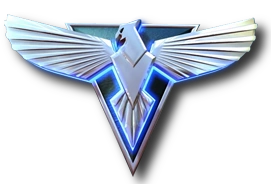

# dsh-mo-startup-screen

> 《红色警戒2：心灵终结》（Mental Omega）主题的 **DeepSeek Harness 开屏动画插件** —— 四大阵营，四套完全独立的开屏序列。

A Mental Omega–themed boot animation plugin for DeepSeek Harness (DSH) Web Client.
Four factions, four independently designed startup sequences.

---

## 目录

- [特性](#特性)
- [四阵营一览](#四阵营一览)
- [安装](#安装)
- [设置项](#设置项)
- [副官语音素材](#副官语音素材)
- [本地调试工具](#本地调试工具)
- [项目结构](#项目结构)
- [开发与测试](#开发与测试)
- [实现说明](#实现说明)
- [常见问题与排错](#常见问题与排错)
- [版权与免责声明](#版权与免责声明)
- [License](#license)

---

## 特性

- **开屏图标页**：仿参考片起始画面 —— DeepSeek 标识亮起，**随所选阵营染成主题色**，
  随后柔和叠化切入阵营序列（不做整屏闪白）；该页保持静默，不出人声。
- **阵营徽标**：左上角阵营名称前显示阵营徽记，设置页的阵营卡片同样使用；
  本地缓存、经白名单路由下发，无外链依赖。
- **四阵营各自独立的 7 幕序列**（图标页 + 6 幕正片），视觉、文案、音效互不套用模板。
- **背景默认不透明**：开屏时完全盖住 DSH 界面，动画不会被应用界面干扰；
  档位可调（不透明 / 几乎不透明 / 半透明+模糊 / 明显透出），并叠加**阵营专属 Canvas 粒子层**。
- **可交互，且是"渐入"的**：关键幕会停下来等确认 —— 先在底部预留区打字机打出一行等待提示，
  **整行打完、停留一拍**后按钮才淡入（外圈呼吸光环），确认后整体淡出。按钮渲染在常驻预留区里，
  不会把上方内容顶动。可在设置里关闭人工确认。
- **副官语音**：每幕预留 `.wav` 语音槽位，素材时长决定该幕停留时间（不会掐断语音）；
  素材缺失回落系统 TTS，素材存在但解不了码则静默并在控制台指出文件。
- **跨渲染器的稳妥实现**：所有图形用内联 SVG 显式坐标绘制，所有动画用 JavaScript 逐帧驱动 ——
  不依赖 `border-radius`、CSS 渐变、CSS transform，也不使用 SMIL。
- **配置实时生效**：设置页可改阵营、指挥官称谓、播放时机、背景档位、语音与音效，支持「立即预览」。
- **可跳过**：右上角 SKIP 按钮，或按 Esc。

---

## 四阵营一览

| 阵营 | 主题色 | 开屏序列（图标页 → 6 幕正片） |
|---|---|---|
| <br>**同盟国联军**<br><sub>ALLIED NATIONS</sub> | 北约蓝 `#4da3ff` | 作战指挥系统 → 卫星链路建立 → **指挥官身份核验** → 超时空传送仪充能 → **作战控制连线** → 欢迎回来，指挥官 |
| <br>**苏维埃联盟**<br><sub>SOVIET UNION</sub> | 钢铁红 `#e0301e` | 战斗警报 → 建立战场控制 → **将军同志身份确认** → 战争工厂全速运转 → 铁幕装置充能 → 欢迎回来，将军同志 |
| <br>**厄普西隆军**<br><sub>EPSILON ARMY</sub> | 幽紫 `#a64dff` | 心灵信标启动 → 接入心灵网络 → **确认异教意志** → 心灵支配仪充能 → 尤里即是主宰 → 欢迎，异教 |
| <br>**焚风反抗军**<br><sub>FOEHN REVOLT</sub> | 青绿 `#2fe0c0` | 捕获加密信号 → 接入沃克网 → **指挥官神经同步** → 纳米同步完成 → 焚风已起 → 欢迎，指挥官 |

> 默认称谓依次为：指挥官 / 将军同志 / 异教 / 指挥官；终幕会喊出你在设置里填的名字。

各阵营的视觉语言：

| 阵营 | 场内图形 | 背景粒子 |
|---|---|---|
| 同盟国联军 | 卫星雷达（同心圆环 + 旋转扇面 + 亮点）、超时空充能环、战区网格 | 蓝色光尘上浮 |
| 苏维埃联盟 | 斜切分段进度条、齿轮组、铁幕六边形脉冲 | 火星飞溅（带闪烁） |
| 厄普西隆军 | 心灵波纹扩散、凝视之瞳、支配仪波形柱、故障抖动大字 | 紫色光球漂移 + 周期涟漪 |
| 焚风反抗军 | 纳米粒子汇聚、六边形蜂格、数据瀑布 | 青绿光尘上浮 |

---

## 安装

### 环境要求

| 项 | 要求 |
|---|---|
| 平台 | DSH **web** profile；桌面端（desktop profile）同样支持 |
| Node | **>= 20**（仅开发与工具脚本需要，插件运行时不依赖 Node） |
| 运行时依赖 | **无**（不执行 `npm install` 也能跑） |

### 方式一：DSH CLI

```sh
# 从 GitHub 安装
dsh plugin --profile web add github:<owner>/dsh-mo-startup-screen

# 桌面端请用 desktop profile
dsh plugin --profile desktop add github:<owner>/dsh-mo-startup-screen

# 本地目录
dsh plugin --profile web add /path/to/dsh-mo-startup-screen
```

装完**重启 dsh web（或完全退出桌面端再启动）**，刷新页面即可看到开屏动画；
设置页会多出「**开屏动画 · 心灵终结**」。

卸载：

```sh
dsh plugin --profile web remove dsh-mo-startup-screen
```

### 方式二：免 CLI 挂载

本插件零运行时依赖，所以只需要两步：建一个目录联接 + 往 profile 的 `bundles` 里加一行。

```sh
node dev/mount-desktop.mjs                # 默认挂到 desktop profile，自动备份 package.json
node dev/mount-desktop.mjs --status       # 只读查看当前挂载状态
node dev/mount-desktop.mjs --unmount      # 卸载并还原配置
node dev/mount-desktop.mjs --profile web  # 想挂到别的 profile
```

脚本会把 `~/.dsh/profiles/<profile>/package.json` 备份为 `package.json.mo-backup`，
可反复执行；卸载后配置逐字节还原。

### 方式三：本地开发挂载

```sh
# 用绝对路径把本地源码插进配置树（改完重启 dsh web 即生效）
dsh web --patch /path/to/dsh-mo-startup-screen/cordis.dev.yml
```

或者干脆不用 DSH，直接跑内置测试台。

---

## 设置项

进入 **DSH 设置页 →「开屏动画 · 心灵终结」**。所有项实时生效，点「▶ 立即预览」可当场看效果。

### 阵营

| 选项 | 默认 | 说明 |
|---|---|---|
| 阵营 | 同盟国联军 | 四张卡片任选，卡片上带阵营徽标与风格说明 |
| 指挥官名称 | 空 | 终幕「欢迎回来，xxx」里的名字；留空则用阵营默认称谓 |

### 播放

| 选项 | 默认 | 说明 |
|---|---|---|
| 启用开屏动画 | 开 | 总开关 |
| 播放时机 | 每个浏览器会话一次 | 也可选「每天一次」「每次打开都播放」 |
| 速度倍率 | 1× | 0.35 – 3 倍 |

### 背景

| 选项 | 默认 | 说明 |
|---|---|---|
| 背景档位 | **不透明** | `不透明` 完全盖住 DSH 界面；另有 `几乎不透明` / `半透明 + 背景模糊` / `明显透出应用界面` |
| 背景不透明度 | 100% | 微调遮罩浓度；`不透明` 档位恒为 100%，切换档位时会自动写入推荐值 |

> 粒子层恒定绘制在遮罩之上，因此即使把不透明度调低，动态效果依然完整可见。

### 交互

| 选项 | 默认 | 说明 |
|---|---|---|
| 需要人工确认 | 开 | 关键幕是否等你确认才继续（提示行打完 → 按钮渐入 → 点击 / Enter / 空格） |
| 允许跳过 | 开 | 右上角 SKIP 与 Esc |

### 副官语音

| 选项 | 默认 | 说明 |
|---|---|---|
| 副官语音播报 | 开 | 总开关 |
| 语音来源 | 副官语音素材 | `副官语音素材`（读 `lib/assets/<阵营>/`）/ `系统 TTS 合成` / `静默` |
| TTS 回落语言 | 中文 | 只在回落到 TTS 时生效：中文 / 英语 / 中英各念一遍 |
| 音量 | 90% | 台词音量 |
| 播报前提示音 | 开 | 念台词前先响两声轻提示 |
| 开口前留白 | 240 ms | 提示音之后停多久再开口 |

该分组底部会实时列出**当前阵营已检测到哪些素材文件**，方便确认素材是否放对位置。

部分副官音频采用`RedAlert2_Adjutant_Voice_Model`生成，需要自定义音频可自行下载并生成：

[gurentan/RedAlert2_Adjutant_Voice_Model · Hugging Face](https://huggingface.co/gurentan/RedAlert2_Adjutant_Voice_Model)

### 界面音效

| 选项 | 默认 | 说明 |
|---|---|---|
| 界面音效 | 开 | 打字机滴答 / 确认音 / 警报 / 风噪等，全部 WebAudio 现场合成，不含音频文件 |
| 音效音量 | 50% | |

---

## 副官语音素材

一句话：**把 `.wav` 丢进 `lib/assets/<阵营>/`，文件名对齐槽位，刷新页面即生效**（无需重启、无需改代码）。

```
lib/assets/
├─ allied/    boot.wav  uplink.wav  verify.wav  chrono.wav  online.wav  finale.wav
├─ soviet/    alarm.wav  control.wav  verify.wav  factory.wav  curtain.wav  finale.wav
├─ epsilon/   beacon.wav  link.wav  will.wav  dominator.wav  master.wav  finale.wav
├─ foehn/     signal.wav  volknet.wav  sync.wav  nano.wav  winds.wav  finale.wav
└─ icons/     DeepSeek 标识 + 四阵营徽标
```

**共 24 个槽位（每阵营 6 个）**。每个槽位的出声时机、推荐音色（盟军 EVA / 苏联副官 /
厄普西隆耳语声线 / 焚风 AI）与推荐台词，见 **[AUDIO.md](AUDIO.md)**。

规则要点：

1. **格式必须是 PCM 16-bit**（`.wav`，22.05k / 44.1kHz 单声道最佳）；`.mp3` 也支持。
   ⚠ **游戏原版语音常是 IMA / MS ADPCM**，浏览器 `decodeAudioData` 解不出来 → 那一段没有声音。
2. **时长建议 1.5–4 秒**：插件按实际音频时长决定该幕停留多久，太长会拖慢整段。
3. **终幕 `finale.wav` 可选**：不放就只有画面与和声钟。
4. 素材缺失 → 回落系统 TTS；**素材存在但解不了码 → 静默 + 控制台指出文件**（不会用 TTS 冒充）。

---

## 项目结构

```
dsh-mo-startup-screen/
├─ package.json          # dsh.bundle + dsh.client 声明
├─ cordis.patch.yml      # bundle patch（按包名引用，供 CLI 安装）
├─ cordis.dev.yml        # 开发用 patch（按绝对路径引用本地源码）
├─ lib/
│  ├─ index.js           # Host 半侧：路由 + index 注入 + 配置持久化
│  ├─ client.js          # 浏览器半侧：设置面板（手写 lazy-CJS bundle，免构建）
│  ├─ splash.css         # 四阵营主题样式
│  ├─ splash.js          # 开屏动画运行时（图标页 + 四阵营序列 + 粒子 + 交互）
│  └─ assets/
│     ├─ <阵营>/         # 副官语音槽位（.wav）
│     └─ icons/          # DeepSeek 标识 + 四阵营徽标
├─ dev/                  # 测试台 / 挂载 / 素材体检与修复 / 图形导出
├─ test/                 # 冒烟 + 三套单测 + 最小 DOM 桩
├─ preview/index.html    # 独立预览页
├─ README.md
├─ AUDIO.md              # 语音槽位清单与推荐台词
└─ LICENSE
```

配置持久化在 `~/.dsh/dsh-mo-startup.json`；音频清单接口 `GET /dsh-mo-startup/assets-manifest`。

---

## 实现说明

几处刻意的设计取舍，都是踩坑之后的结论：

1. **Host 半侧不依赖任何外部包**，只 import Node 内置模块；浏览器半侧是手写的 lazy-CJS bundle。
   因此**不需要构建、不需要 `npm install`**，也不受 profile 依赖解析状态影响。
2. **图形用内联 SVG 显式坐标绘制**。早先用 `border-radius` + CSS 渐变画圆，
   在部分渲染器里被裁成了"圆角方块"。
3. **动画用 JavaScript 逐帧 `setAttribute` 驱动**。早先用 SMIL（`animate` / `animateTransform`），
   在部分渲染器（含桌面端 webview）里不执行，导致齿轮完全定格。
4. **背景默认不透明**：半透明时 DSH 界面会透过遮罩干扰动画；粒子层位于遮罩之上，
   所以调低不透明度也不影响动态效果。
5. **确认按钮渲染在底部常驻预留区**（绝对定位），而不是插进正文流 —— 否则按钮出现时会把版面顶动。
6. **音画同步按语音时长驱动**：每幕停留 = `max(视觉基准, 实际语音时长 + 240ms)`，点得再快也不会掐断语音。
7. **免构建的设置面板**：设置页不走 `dsh-settings` 命名空间，而是自带 HTTP API
   （`/dsh-mo-startup/config`），少受依赖版本变化影响。

---

## 常见问题与排错

**某一段语音没有声音**
多半是素材编码问题（游戏原版语音常见 IMA / MS ADPCM，浏览器解不出来）。
跑 `node dev/check-audio.mjs` 看格式，再用 `node dev/fix-audio.mjs` 批量转成 PCM 16-bit。

**`dsh plugin add` 反复失败**
先确认 profile 的依赖是否完好：若 `~/.dsh/profiles/node_modules/@deepseek-ai/*`
是指向别处的**断链**（例如曾把 CLI 装进系统目录、之后被清理），CLI 就无法解析 profile 依赖。
可以重装 CLI 到用户目录（`npm config set prefix "%APPDATA%\npm"` 后 `npm i -g dsh`），
再进 profile 目录执行 `pnpm install` 重建依赖；或者直接用 `dev/mount-desktop.mjs` 绕过 CLI。

**改了代码没生效**
`lib/splash.js`、`lib/splash.css` 由 Host 按文件 mtime 实时读取，刷新页面即可；
`lib/index.js`、`lib/client.js` 改动需要重启 dsh web / 桌面端。浏览器若缓存了页面，强刷（Ctrl+F5）。

**设置页没有出现「开屏动画 · 心灵终结」**
说明 Host 半侧没挂上（浏览器半侧的设置卡片需要与它配对）。先用
`node dev/mount-desktop.mjs --status` 确认挂载状态，或查看启动日志里是否有插件加载信息。

**想只看某个阵营 / 只验视觉**
浏览器打开 `preview/index.html?faction=foehn`，或用测试台（`dev/harness.mjs`）右下角工具栏切换。

---

## 版权与免责声明

- 本项目为**个人学习与娱乐性质**的开源插件，不用于任何商业目的。
- 《红色警报 2》《尤里的复仇》及《心灵终结》（Mental Omega）的相关名称、阵营设定、
  徽标等权利均归原权利人所有；本项目不对其主张任何权利，也未获得任何授权或背书。
  仓库中的阵营徽标取自 Mental Omega 社区维基，仅作个人学习交流之用。
- DeepSeek 标识来自 [Simple Icons](https://simpleicons.org/)（MIT），已改为随阵营动态着色。
- 本项目的开源许可**仅覆盖作者原创的代码、样式与文案**。

---

## License

[MIT](LICENSE)
